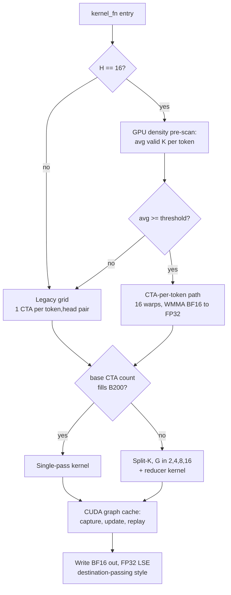
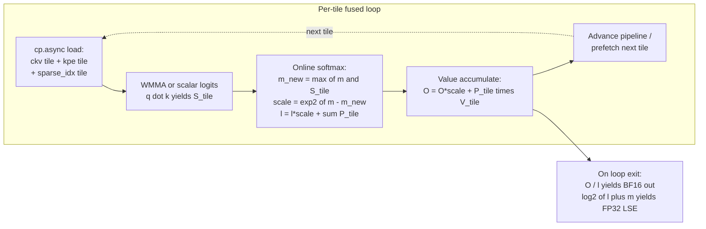
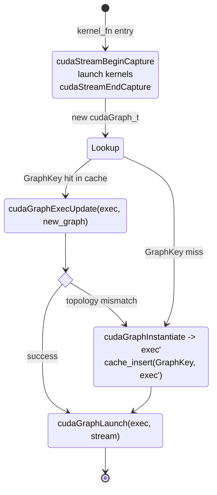

# Wombat DSA Sparse Attention: Process Write-Up Template

Author: Yury Kirpichev / Team Wombat  
Track: `dsa_sparse_attention_h16_ckv512_kpe64_topk2048_ps64`  
Submission tags: `submission-v1`, `submission-final`, `submission-final-v2`  
Final solution: `wombat_dsa_sparse_mla_sm100a_final`

## Headline Summary

| Field | Value |
|---|---|
| Track / definition | `dsa_sparse_attention_h16_ckv512_kpe64_topk2048_ps64` |
| Hardware target | NVIDIA B200 / `sm_100a` (BF16, FP32 LSE) |
| Submission tag | `submission-final-v2` (commit `de475b9`) |
| Workloads passed | 23 / 23, `abs_err <= 1.56e-2` |
| Geomean vs PyTorch reference | 126.03x (cupti-timed) |
| Geomean vs FlashInfer baseline | 14.18x (cupti-timed) |
| Aggregate single-pass latency | 0.719 ms (vs 6.793 ms FlashInfer, 66.079 ms PyTorch) |
| Per-workload latency band | 0.003 ms - 0.052 ms |
| Source files in submission | `solution/python/solution.py`, `solution/python/kernel.cu` |
| Development methodology | Agent-assisted (Cursor + LLM agents); all decisions and commits owned by the human author. See "AI / Agent-Assisted Development Disclosure" before the References. |

> Caveat: the headline speedups versus the PyTorch reference and the
> FlashInfer baseline are both measured with `cupti-python` in the same
> Modal invocation. The isolated contribution of the in-kernel CUDA graph
> cache, however, was **not** disambiguated from the cupti-vs-events timing
> methodology delta and would need to be remeasured (see "Measurement scope
> and limitations" on Page 4).

## Page 1: Problem, Constraints, and Development Method

The goal of this submission was to implement the DSA sparse MLA attention
operator for the MLSys 2026 FlashInfer AI Kernel Generation Contest on NVIDIA
B200 / `sm_100a`. The operator receives per-token query tensors
`q_nope` and `q_pe`, compressed KV caches `ckv_cache` and `kpe_cache`, and
`TOPK=2048` sparse indices. It writes a BF16 output tensor and FP32 log-sum-exp
tensor in destination-passing style. The practical challenge was not only to
implement the mathematical attention computation, but to make it competitive
on the contest workload distribution, where many shapes are small enough that
launch overhead, occupancy, memory scheduling, and sparse-index density are
as important as raw arithmetic throughput.

The work followed an experiment-driven loop. Each optimization was introduced
on a branch or phase, benchmarked on Modal B200 where possible, and either
kept, refined, or reverted. This produced a history with both positive and
negative results. The negative results were useful: they established that some
apparently natural ideas, such as head tiling, wider value prefetching, full
warp specialization, and Blackwell UMMA for this shape, did not fit the
operator's actual bottleneck. The final code therefore reflects a sequence of
measured decisions rather than a single monolithic kernel rewrite.

The development was **agent-assisted**: Cursor and large-language-model
coding agents were used as a pair-programming and refactoring tool throughout
the project. All design decisions, optimization choices, benchmark setups,
correctness checks, and final commits were owned and reviewed by the human
author; agent output was treated as a draft to be evaluated against measured
B200 results, not as ground truth. A more detailed disclosure - what the
agent helped with, what was strictly human-driven, and how outputs were
verified - is given in the "AI / Agent-Assisted Development Disclosure"
section before the References.

The early baseline work established the evaluation harness and correctness
contract. The repository first added a FlashInfer/PyTorch reference comparison
flow and a Triton/PyTorch baseline, then moved to a CUDA implementation with
PyTorch extension and TVM-FFI style bindings. The first useful CUDA baseline
already targeted B200 and used a simple per-token/per-head sparse attention
mapping. Subsequent Stage 1 and Stage 2 commits batched low-risk improvements:
packed BF16 output stores, fused normalization, and a fused online-softmax
structure. At this point the kernel was already materially faster than the
Python reference, but profiling showed that long traces and small launch grids
still left substantial performance on the table.

The first major design principle that survived to the final solution was to
reduce repeated HBM traffic. Earlier versions separated logit calculation,
softmax, and value accumulation in ways that caused the compressed value cache
to be read more than once. The `v5_fused` work changed this into a fused
single-pass online-softmax K loop. The kernel maintains the running maximum,
normalizer, and output accumulation state while consuming each sparse KV tile.
This made each loaded tile useful immediately and reduced memory traffic.
According to the git history, this step produced a meaningful geomean win and
became the base for later work.

The second principle was to preserve correctness while accepting small BF16
output quantization only at the final output boundary. Several experiments
showed that storing intermediate logits or split-K partial outputs in BF16 was
not numerically robust enough across the full workload set. The final split-K
path therefore uses FP32 partial output buffers and only converts to BF16 when
writing the final result. This choice increased temporary memory bandwidth but
removed intermittent absolute-error spikes observed in earlier split-K variants.

The third principle was to treat the workload set as a collection of shape and
density families rather than as a single kernel regime. The final submission
keeps multiple correct execution paths: a legacy per-`(T,H)` grid, a split-K
variant for underfilled grids, and a CTA-per-token path that processes all
16 heads in one CTA when the density profile favors it. A lightweight
GPU-side sparse-index density pre-scan selects between the CTA-per-token and
legacy paths. This is a runtime dispatch heuristic; both paths compute the
attention output and LSE from the current input tensors.

## Page 2: Chronological Optimization Story

The repo history naturally clusters into eight phases. The figure below
summarizes the spine of the development process, including positive results
that survived to the final submission and intentionally rejected experiments.

```mermaid
flowchart LR
    P0[Phase 0<br/>Baselines and<br/>Modal harness]
    P1[Phase 1<br/>CUDA stages 1-3:<br/>cp.async, fused softmax]
    P2[Phase 2<br/>Negative results:<br/>head tiling, V_PIPE,<br/>bf16 logits]
    P3[Phase 3<br/>Split-K G in<br/>1,2,4,8,16]
    P4[Phase 4<br/>sm_100a, TMA,<br/>warp-spec experiments]
    P5[Phase 5<br/>CTA-per-token<br/>WMMA path]
    P6[Phase 6<br/>FP32 split-K partials<br/>and density gate]
    P7[Phase 7<br/>Torch JIT packaging<br/>and CUDA graph cache]

    P0 --> P1 --> P2 --> P3 --> P4 --> P5 --> P6 --> P7

    classDef kept fill:#dff5dd,stroke:#3a8f3a,color:#000
    classDef rejected fill:#f8d7d2,stroke:#a44,color:#000
    class P0,P1,P3,P5,P6,P7 kept
    class P2,P4 rejected
```

Phase 0 established baselines and measurement. The initial repository started
from the starter kit, added Modal full-suite runners, and recorded FlashInfer
and PyTorch reference behavior. The first contest-ready implementation was a
batched PyTorch MLA baseline, followed by Triton and then CUDA baselines. This
phase was mainly about having a repeatable workflow: pack the solution, run the
same workload set, and archive logs for comparisons. The important output was
not the fastest kernel but a stable way to measure progress.

Phase 1 moved the implementation into CUDA and applied low-risk throughput
improvements. Commits around `stage1/batched-optimizations` and
`stage2/fused-online-softmax` introduced packed output operations and fused
normalization. The Stage 3 work then targeted memory movement. The value
projection path added `cp.async` double buffering, followed by a logit prefetch
path. The history records substantial speedups from these changes, especially
when moving from Stage 3b value prefetch to Stage 3c logit prefetch.

Phase 2 explored alternatives that were intentionally not kept. Head tiling
with `H_TILE=2` looked attractive because it increased per-CTA work, but it
regressed and was reverted. A grid order that made head the fast dimension was
also attempted and reverted. Increasing pipeline depth from `V_PIPE=2` to
larger values regressed due to register pressure and scheduling costs. BF16
logit storage was also reverted because it introduced precision problems.
These negative results pushed the design back toward a narrower, highly tuned
per-tile pipeline with FP32 accumulation where it mattered.

Phase 3 introduced FlashDecoding-style split-K. The key observation was that
some workloads had too few base CTAs (`T*H`) to fill the B200. Splitting the
K dimension into `G` groups increased parallelism and used a reducer kernel to
combine partial online-softmax states. This phase used `G` in `{1,2,4,8}` and
later extended the dispatcher to include `G=16` for a narrow CTA-count tier.
The final implementation retains split-K when the base grid would underfill
the SM array and falls back to the single-kernel path when launch overhead
would dominate.

Phase 4 explored Blackwell-specific memory and scheduling features.
The codebase added sm_100a cleanup, removed redundant synchronization, and
experimented with TMA/gather-style loading and warp-specialized issue paths.
Some of this work was correct but did not improve the final benchmark. The TMA
and full WS3 paths were either archived or disabled because the measured
latency regressed. These experiments still informed the final design: the
winning path uses simpler async copy patterns and avoids over-specializing the
kernel around an issue/consumer split that starved the useful arithmetic.

Phases 5 and 6 produced the final kernel architecture. The CTA-per-token path
uses 512 threads, one warp per head, and WMMA BF16xBF16 to FP32 for both logit
calculation and value accumulation. It batches all `H=16` heads inside a CTA,
uses persistent accumulator fragments, and stores/rescales/reloads FP32
fragments to handle online-softmax rescaling safely. Phase 6 also moved split-K
partial output buffers to FP32, eliminating the intermittent absolute-error
spikes seen on long traces with BF16 partials, and added a GPU-side
sparse-index density pre-scan that routes high-density shapes to the
CTA-per-token kernel and low-density shapes back to the legacy grid, avoiding
the fixed CTA-per-token floor on sparse low-density inputs.

Phase 7 finalized packaging and launch overhead. The final submission moved to
a Python solution that JIT-compiles `kernel.cu` with
`torch.utils.cpp_extension.load` so that the submission can pass explicit
`-gencode arch=compute_100a,code=sm_100a` flags. This matched the contest FAQ's
recommended workaround for custom compile flags and made the sm_100a-only code
self-contained in the submitted sources. The final branch added a CUDA graph
cache around the launch topology: each call captures the current kernel launch
sequence, updates a cached `cudaGraphExec_t` with the current tensor pointers
when possible, and launches the graph on the caller stream. Follow-up cleanup
removed debug environment-variable plumbing so the final `submission-final-v2`
tag contains the unconditional graph-cache path without extra diagnostic code.

## Page 3: Final Kernel Design

The final kernel is a small dispatcher plus a set of specialized CUDA kernels.
The host wrapper validates tensor device, dtype, and shape, computes the flat
KV row count, converts `sm_scale` into base-2 scale, chooses a path, ensures
scratch buffers are large enough, and then launches through the CUDA graph
cache. The submitted `solution.py` has no external runtime dependencies beyond
PyTorch and the CUDA extension build path.

The dispatcher logic is summarized below.

The legacy kernel maps one CTA to one `(token, head)` pair. Each CTA first
loads the query vectors and sparse indices. Sparse indices are prescanned with
vectorized `int4` loads and invalid entries are canonicalized to `-1`; invalid
KV rows are zero-initialized in shared memory rather than fetched from global
memory. The K loop is fused: a tile of compressed value and positional key data
is loaded, logits are computed, the online-softmax running state is updated,
and the value contribution is accumulated. This keeps memory traffic close to
one use per tile and avoids materializing a full `TOPK` logit array.

The fused K-loop pipeline is sketched below. The key property is that each
loaded tile is consumed in three steps before the next tile arrives, and
neither the full `TOPK` logit vector nor an intermediate softmax array is ever
materialized.

The split-K path handles small grids that would otherwise underfill B200.
For a chosen split factor `G`, each partial kernel processes a K slice and
writes FP32 partial output, maximum, and normalizer buffers. A reducer combines
the `G` online-softmax states using the same max/sum rescaling identity and
writes the final BF16 output plus FP32 LSE. Scratch buffers are persistent but
their contents are recomputed by the kernels for each run. The final version
uses FP32 partial output storage because BF16 partials caused intermittent
accuracy spikes.

The CTA-per-token path is the fastest path for dense enough `H=16` workloads.
It assigns one CTA to a token and, when needed, one split-K group. The CTA has
16 warps, one per head. It uses WMMA for a small dense matrix formulation of
the logit step and the value accumulation step. This design converts the
16-head batch into work that better matches tensor-core instructions while
keeping online-softmax state per head. The kernel uses shared memory overlays
for MMA scratch and output scratch because these buffers are live in disjoint
phases. This was one of the main late-stage wins over the older scalar
per-head path.

The density pre-scan is a dispatch mechanism. It counts valid sparse-index
entries on the GPU, computes average valid K per token, and selects the
CTA-per-token path only when the density is high enough to amortize its fixed
cost. Low-density examples such as `385742b2` and `4c46a94b` are routed to the
legacy path. In report language, this should be described as follows:
"A GPU pre-scan computes sparse-index density to select between two correct
kernels; the attention output and LSE are always recomputed from the current
input tensors."

The CUDA graph cache addresses launch overhead on the smallest workloads.
The graph cache is keyed by stream, shape, KV row count, scale bits, dispatch
path, and split factor. It does not key on tensor pointers; instead, each call
captures a fresh graph containing the current pointers, then attempts
`cudaGraphExecUpdate` against the cached executable graph. If the topology
matches, the updated executable is launched. If not, the cache entry is
re-instantiated. This caches launch topology rather than attention results,
and the launched kernels still read the current tensors.

Several features were deliberately not adopted. Blackwell `tcgen05.mma`/UMMA
was investigated but did not match the problem shape well: the natural tile
expects far larger N dimensions, while the value accumulation here is closer
to a GEMV/skinny-GEMM problem. Full warp specialization was correct but slower
because useful work became issue-slot limited. TMA/gather-style attempts and
some deeper pipeline variants also failed to beat the simpler async-copy path.
Keeping these negative results in the process narrative is important because
they explain why the final code is not simply "use every Blackwell feature."

## Page 4: Validation, Results, and Reproducibility

Correctness was checked continuously through the benchmark harness and final
Modal B200 runs. The final submitted solution reports all 23 workloads passing.
The cupti-timed comparison run for `submission-final-v2` reports finite
latencies for every workload, with the separate benchmark run reporting
`23/23 PASSED` and `abs_err <= 1.56e-2`. The final output remains within the
contest tolerances while using BF16 output and FP32 LSE.

Performance was measured against both the PyTorch reference and the FlashInfer
baseline using `cupti-python`, matching the official evaluator backend.

| Metric (cupti-timed, B200) | Submitted | FlashInfer | PyTorch ref |
|---|---:|---:|---:|
| Aggregate latency over 23 workloads | 0.719 ms | 6.793 ms | 66.079 ms |
| Geomean speedup vs PyTorch ref | 126.03x | n/a | 1.00x |
| Geomean speedup vs FlashInfer | 14.18x | 1.00x | n/a |
| Min / max per-workload latency | ~0.003 / ~0.052 ms | -- | -- |
| Workloads passed | 23 / 23 | -- | -- |
| Max abs error | 1.56e-2 | -- | -- |

The result should be interpreted with the timing backend in mind. Earlier
reports used CUDA-event fallback timing and showed lower apparent speedups
because event overhead was significant for sub-10-microsecond kernels. The
final report reran the comparison with `cupti-python`, matching the evaluator
environment described in `EVALUATION.md`, and this is the number set that
should be cited in the final write-up. The older event-timed comparison is
still useful as a regression check, but not as the primary performance claim.

### Measurement scope and limitations

The headline `vs PyTorch reference` (126.03x) and `vs FlashInfer baseline`
(14.18x) numbers are clean apples-to-apples comparisons: the FlashInfer
baseline and the submitted kernel were benched **in the same Modal
invocation, on the same B200 instance, in the same container, with
`cupti-python` as the timing backend** for both
(`artifacts/compare/REPORT_submission_final_v2_cupti_20260424T090435Z.md`,
metadata + raw per-workload numbers). These numbers therefore reflect what
the official cupti-based evaluator would see and are not inflated by
event-timing overhead.

What was **not** measured is the isolated contribution of the in-kernel CUDA
graph cache. The `vs prev` column in the comparison report compares current
cupti-timed latencies against an earlier `WOMBAT_CUDA_GRAPH=0` run that was
CUDA-event timed, so that ratio conflates two effects: (i) the CUDA-event
versus cupti timing methodology, and (ii) the graph cache being on versus
off. A clean A/B for the graph cache alone would require a cupti-timed run
with the graph cache disabled, but the `submission-final-v2` kernel makes
the graph cache unconditional and removed its disable knob before the
cleanup window closed; this run was therefore not produced due to time
constraints. **It should be remeasured if a clean attribution between
"better measurement methodology (cupti)" and "in-kernel CUDA graph cache" is
required**, by reintroducing a temporary compile-time switch to bypass the
graph cache and rerunning the comparison harness with `cupti-python`. The
current report should not claim a specific speedup for the graph cache
feature in isolation.

The development process relied on archived logs rather than one-off manual
measurements. Relevant artifacts include Stage 3 and Phase 5/6/7 logs, final
comparison logs, graph-cache A/B and cleanup logs, and the final cupti-timed
comparison report. The git tags capture milestones: `submission-v1` for the
earlier clean baseline, `submission-final` for the Torch-extension final
kernel before graph-cache cleanup, and `submission-final-v2` for the cleaned
graph-cache branch. The final source package contains `solution.py` and
`kernel.cu` only, and `config.toml` declares a Python DPS entry point:
`solution.py::run`.

Suggested final conclusion:

This submission was produced by a measurement-driven optimization process that
combined simple memory-system improvements, online softmax fusion, split-K
parallelism, shape/density-aware dispatch, tensor-core use for the 16-head
CTA-per-token path, and CUDA graph replay for launch overhead. The final
implementation passes all public workloads and improves substantially over both
the Python reference and the FlashInfer baseline while remaining self-contained
and limited to source code included in the submission.

## AI / Agent-Assisted Development Disclosure

This submission was produced with substantial assistance from AI coding
agents (Cursor with Anthropic Claude family and OpenAI GPT family
backends). The full disclosure - what the agents were used for, what
was strictly human-driven, and how every agent output was verified
against measured B200 results - is kept in a separate appendix file to
keep this report at four pages:
[`REPORT_AI_DISCLOSURE.md`](https://github.com/ykirpichev/dsa_sparse_attention_h16_ckv512_kpe64_topk2048_ps64/blob/reports/submission-final-v2-draft/REPORT_AI_DISCLOSURE.md).
In short: the *direction* of the work was human, the *typing* of the
code was substantially shared with agents, and the *acceptance criteria*
for any change were always measured cupti-timed B200 numbers.

## References

All in-repo references below are pinned to the `submission-final-v2` tag
(commit `de475b9`) of the submission repository:
[`ykirpichev/dsa_sparse_attention_h16_ckv512_kpe64_topk2048_ps64`](https://github.com/ykirpichev/dsa_sparse_attention_h16_ckv512_kpe64_topk2048_ps64).

### Submitted source

1. Final kernel implementation -
   [`solution/python/kernel.cu`](https://github.com/ykirpichev/dsa_sparse_attention_h16_ckv512_kpe64_topk2048_ps64/blob/submission-final-v2/solution/python/kernel.cu).
2. Python entry point and JIT compile flags -
   [`solution/python/solution.py`](https://github.com/ykirpichev/dsa_sparse_attention_h16_ckv512_kpe64_topk2048_ps64/blob/submission-final-v2/solution/python/solution.py).
3. Submission manifest (DPS entry point, language) -
   [`config.toml`](https://github.com/ykirpichev/dsa_sparse_attention_h16_ckv512_kpe64_topk2048_ps64/blob/submission-final-v2/config.toml).

### Contest documentation in the repo

4. Contest rules and submission contract -
   [`README.md`](https://github.com/ykirpichev/dsa_sparse_attention_h16_ckv512_kpe64_topk2048_ps64/blob/submission-final-v2/README.md).
5. FAQ (allowed optimizations, persistent buffers, custom compile flags) -
   [`FAQ.md`](https://github.com/ykirpichev/dsa_sparse_attention_h16_ckv512_kpe64_topk2048_ps64/blob/submission-final-v2/FAQ.md).
6. Evaluation environment (Docker image, hardware, `cupti-python`) -
   [`EVALUATION.md`](https://github.com/ykirpichev/dsa_sparse_attention_h16_ckv512_kpe64_topk2048_ps64/blob/submission-final-v2/EVALUATION.md).
7. Submission summary, integrity checklist, kernel architecture -
   [`SUBMISSION.md`](https://github.com/ykirpichev/dsa_sparse_attention_h16_ckv512_kpe64_topk2048_ps64/blob/submission-final-v2/SUBMISSION.md).

### Tags and commit history

8. Tag `submission-v1` (early clean baseline) -
   [`7e1a3497`](https://github.com/ykirpichev/dsa_sparse_attention_h16_ckv512_kpe64_topk2048_ps64/releases/tag/submission-v1).
9. Tag `submission-final` (Torch-extension final kernel before graph-cache
   cleanup) -
   [`7d585157`](https://github.com/ykirpichev/dsa_sparse_attention_h16_ckv512_kpe64_topk2048_ps64/releases/tag/submission-final).
10. Tag `submission-final-v2` (cleaned graph-cache branch, this submission) -
    [`b4f055b1`](https://github.com/ykirpichev/dsa_sparse_attention_h16_ckv512_kpe64_topk2048_ps64/releases/tag/submission-final-v2).
11. Full chronological history -
    [`git log --all --decorate --date=short`](https://github.com/ykirpichev/dsa_sparse_attention_h16_ckv512_kpe64_topk2048_ps64/commits/submission-final-v2).

### Performance and correctness artifacts

> Note: the `artifacts/` directory was not committed at the
> `submission-final-v2` tag. To make the links below resolve, either commit
> the artifacts to a follow-up branch (for example `reports/submission-final-v2`)
> and update the URLs to that branch, or attach the relevant files to a
> GitHub release for the tag. The paths below are the canonical paths in the
> working tree.

12. Final cupti-timed comparison report (vs PyTorch ref and FlashInfer
    baseline, same Modal invocation) -
    `artifacts/compare/REPORT_submission_final_v2_cupti_20260424T090435Z.md`.
13. Raw Modal log for the cupti-timed comparison -
    `artifacts/compare/compare_submission_final_v2_cupti_20260424T085836Z.log`.
14. Graph-cache cleanup benchmark, confirms `23/23 PASSED` -
    `artifacts/graph_cache/bench_cleanup_20260424T083607Z.log`.
15. Earlier event-timed comparison (kept as regression check, not the
    headline number) -
    `artifacts/compare/REPORT_submission_final_v2_20260424T085540Z.md`.
16. Graph-cache A/B logs (graph-on / graph-off / probe runs) -
    `artifacts/graph_cache/`.
17. Aggregate per-phase experiment logs and ablations -
    `artifacts/`.

### External references

18. NVIDIA CUDA C++ Programming Guide, CUDA graphs and `cudaGraphExecUpdate` -
    [docs.nvidia.com/cuda/cuda-c-programming-guide/index.html#cuda-graphs](https://docs.nvidia.com/cuda/cuda-c-programming-guide/index.html#cuda-graphs).
19. NVIDIA CUDA C++ Programming Guide, `nvcuda::wmma` API -
    [docs.nvidia.com/cuda/cuda-c-programming-guide/index.html#wmma](https://docs.nvidia.com/cuda/cuda-c-programming-guide/index.html#wmma).
20. PyTorch JIT C++/CUDA extensions, `torch.utils.cpp_extension.load` -
    [pytorch.org/docs/stable/cpp_extension.html](https://pytorch.org/docs/stable/cpp_extension.html).
21. Dao et al., "FlashAttention: Fast and Memory-Efficient Exact Attention with
    IO-Awareness", NeurIPS 2022 -
    [arXiv:2205.14135](https://arxiv.org/abs/2205.14135).
22. Dao, "FlashAttention-2: Faster Attention with Better Parallelism and Work
    Partitioning", 2023 -
    [arXiv:2307.08691](https://arxiv.org/abs/2307.08691).
23. Hong et al. / FlashDecoding, "Flash-Decoding for long-context inference",
    Stanford CRFM blog post, 2023 -
    [crfm.stanford.edu/2023/10/12/flashdecoding.html](https://crfm.stanford.edu/2023/10/12/flashdecoding.html).
24. FlashInfer attention library (baseline used by the contest harness) -
    [github.com/flashinfer-ai/flashinfer](https://github.com/flashinfer-ai/flashinfer).
25. MLSys 2026 FlashInfer AI Kernel Generation Contest entry definitions -
    [github.com/flashinfer-ai/mlsys26-contest](https://github.com/flashinfer-ai/mlsys26-contest).
